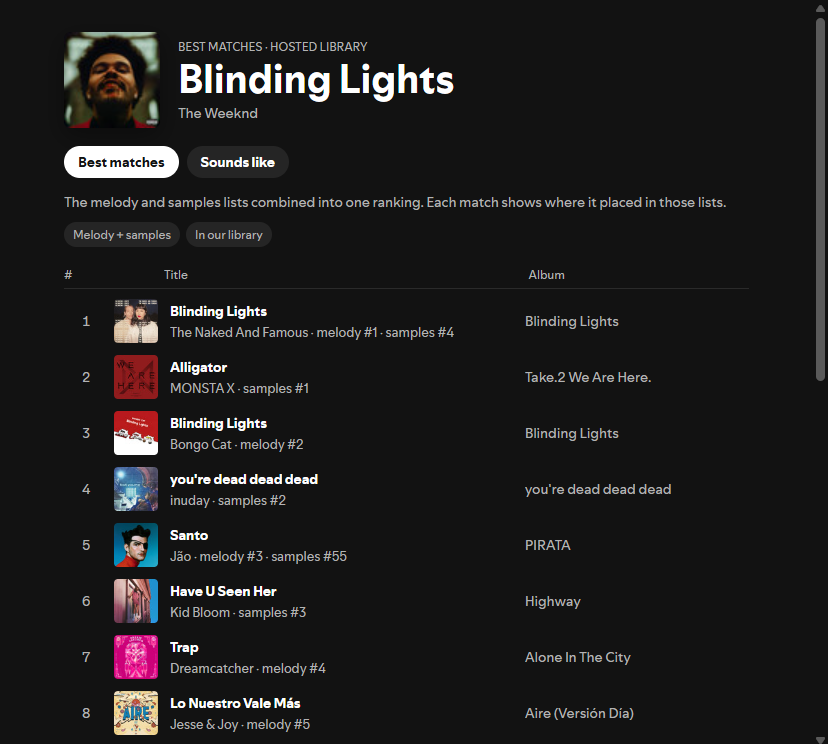
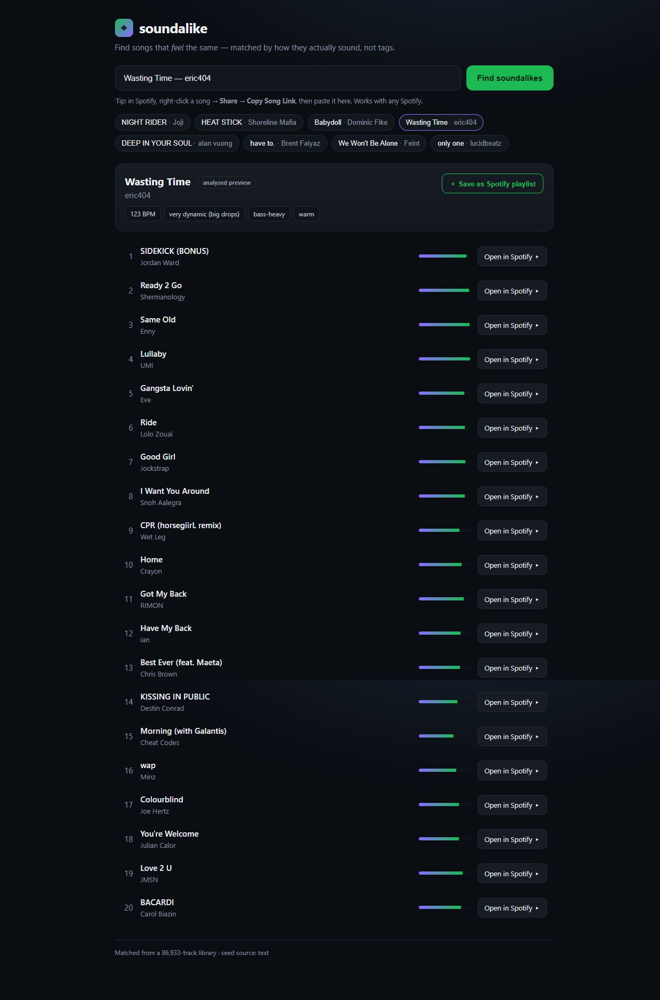

# Soundalike

Find songs that sound like a track you already enjoy.

[Try the web app](https://soundalike.yassin.app) |
[Install it in Spotify](integrations/spicetify/README.md) |
[Help evaluate matches](https://soundalike.yassin.app/evaluate) |
[Report a bug](https://github.com/yassinsolim/soundalike/issues/new?labels=bug&title=Bug%3A%20) |
[Request a feature](https://github.com/yassinsolim/soundalike/issues/new?labels=enhancement&title=Feature%20request%3A%20)

I started Soundalike as a small university project and kept rebuilding it as
Spotify's APIs changed and the catalog grew. Today it is an open-source music
recommender built around audio similarity. It compares precomputed audio
representations and measured features such as tempo, dynamics, and bass
balance. It does not use your listening history as a ranking signal.

The public web app and Spicetify extension use a catalog of 272,853 tracks.
The repository also includes a local app, command-line tools, smaller bundled
indexes, and the research code used to test new ranking ideas.

I am still improving the recommendations. If you try it, specific examples of
great or poor matches are always useful.



## Choose how you want to use it

### Inside Spotify

This is the easiest way to use Soundalike regularly.

1. Install [Spicetify](https://spicetify.app/docs/getting-started/).
2. Open Marketplace in Spotify.
3. Search for **Soundalike** under Extensions and install it.
4. Restart Spotify if Marketplace asks you to.
5. Right-click a track and select **Find soundalikes**.

Results open on their own Spotify page. You can play a result, open its album,
use Spotify's normal track menu, or search for another set of matches.

Marketplace installs receive signed runtime updates when Spotify starts. The
loader verifies the release signature, immutable commit URL, SHA-256 hash, and
browser integrity value before it runs an update. If verification or download
fails, it uses the last verified version.

If you installed Soundalike before the signed updater was introduced, or if
**Find soundalikes** is missing, remove the extension from Marketplace, install
it once more, and restart Spotify. Later runtime updates should not require
another reinstall.

See the [Spicetify guide](integrations/spicetify/README.md) for privacy details,
manual installation, supported Spotify builds, and troubleshooting.

### In a browser

Open <https://soundalike.yassin.app>.

You do not need an account to search the hosted catalog. Spotify login is
optional and is only used when you ask the site to save a playlist. Spotify
handles the authorization through OAuth; Soundalike never receives your
password.



### On a phone

Spotify does not allow anything to modify its mobile apps, so there is no mobile
equivalent of the Spicetify extension. There is a companion app instead. You
share a track from Spotify, pick Soundalike, and get the same twenty matches.
Tapping a result opens it back in Spotify.

It does not ask you to sign in and it has no Spotify credentials in it. It reads
the public page for the track you shared and searches the same catalog as the
website.

The app is not on the App Store or Google Play yet. To build and run it now, see
the [mobile guide](mobile/README.md).

### As a local app or command-line tool

Clone the repository and create a virtual environment:

```bash
git clone https://github.com/yassinsolim/soundalike.git
cd soundalike
python -m venv .venv
```

Activate it on Windows:

```powershell
.\.venv\Scripts\Activate.ps1
```

Or activate it on macOS and Linux:

```bash
source .venv/bin/activate
```

Install the basic command-line tools:

```bash
python -m pip install -e .
soundalike similar --title "Blinding Lights" -n 10
```

Install the audio and model dependencies for the local web app:

```bash
python -m pip install -e ".[ml]"
soundalike fetch-index
soundalike serve
```

The local app opens at <http://127.0.0.1:8787>. It accepts a title and artist
or a Deezer track link. Spotify track links work after you complete the Spotify
setup.

For commands that read your Spotify library or use Last.fm, follow
[SETUP.md](SETUP.md).

## What the Spotify extension does

The extension keeps the model ranking and Spotify-specific checks separate:

1. It sends the selected track title and artist to the Soundalike service.
2. The service retrieves candidates from the audio index and applies the
   production ranking policy.
3. Spotify resolves the returned tracks inside the desktop client.
4. If Spotify has a known lyrics language for the seed, candidates are shown
   only after the same language is confirmed.

The visible ranking includes a few practical safeguards:

- Audio similarity defines the candidate pool.
- Popularity signals cannot pull a distant track into that pool.
- Large tempo and dynamics mismatches receive a small penalty.
- Remix, live, acoustic, and other version families are collapsed so one
  recording does not occupy several visible slots.
- A different song by the same artist is still allowed when it ranks well.
- Low-confidence Spotify matches are never played automatically.

Strict language filtering can return fewer than 20 songs. A missing lyrics
language is treated as unknown, not as proof that a song is in another
language.

The extension caches successful recommendations and resolved Spotify metadata
for seven days. Failed language checks and unresolved Spotify searches are not
cached, so temporary failures can recover.

## Privacy

For a hosted recommendation, Soundalike receives:

- the seed title and artist;
- the requested result count and ranking options.

The extension does not send your Spotify password, access token, library,
listening history, or artwork. Lyrics-language and related-artist lookups happen
inside your authenticated Spotify client.

After results settle, the extension may show a short **Good**, **Mixed**, or
**Off** survey. Nothing is submitted until you press **Send feedback**. A
feedback record contains the seed, the rows you were shown, model policy
labels, your selected reasons, an optional note, and random anonymous
deduplication values. Do not put personal information in the note.

The feedback endpoint does not receive your Spotify identity, credentials,
tokens, library, listening history, hidden candidates, or a private storage
URL.

The maintainer may receive a private Discord notification containing the
Good/Mixed/Off selection, seed title and artist, selected reasons, number of
displayed results, and a short receipt. Optional notes, anonymous nonces, and
the displayed result list are not sent to Discord.

The mobile companion app has no Spotify sign-in at all. When you share a track
it reads that track's public Spotify page for the title, artist, and cover, then
sends only the title and artist to the recommendation service. It does not read
your library, history, or playlists. Its feedback survey follows the same rules
as the extension.

The mobile app can also update its own JavaScript without a store release, so
fixes can ship in minutes rather than days. That check runs in the background at
launch, goes to Expo's update service, and carries the platform, a runtime
version, and the IP address any web request would carry. It does not carry an
account, a device identifier, or anything about your listening. Details are in
the [mobile guide](mobile/README.md).

## How recommendations are built

The production ranker uses two compact audio representations:

- an EfficientNet-derived representation for timbre and texture;
- a calibrated CLAP representation for broader acoustic similarity.

The system combines them, limits contextual reordering to the top 1,000
audio-qualified candidates, applies quality and pacing safeguards, and returns
the final list. The hosted and local numpy ranking paths have parity tests to
keep their ordering consistent.

The current production method is `dual_sonic64_guardrail` with ranking policy
`model-quality-v1`. On the frozen 20-pair pure-sonic benchmark, Recall@50 is
0.10 compared with 0.05 for the earlier production baseline. That benchmark is
small and should not be read as proof that every listener will prefer every
result. Listening feedback remains the more useful signal for subjective
quality.

For the full engineering history, failed experiments, benchmark design, and
resource measurements, read:

- [Case study](docs/CASE_STUDY.md)
- [V3 research log](docs/V3_RESEARCH.md)
- [Full-track research notes](docs/FULLTRACK_AUDIO.md)

The full-track MTG-Jamendo work is research tooling. It is not used to acquire
Spotify audio, and it is not presented as the production commercial-catalog
model.

### Any-song (beta)

[`/anysong`](https://soundalike.yassin.app/anysong) matches any Deezer track, even
one outside the catalog, by melody, samples and overall sound, embedding unseen
songs live on a GPU. Architecture, index builds and deployment are described in
[docs/ANYSONG.md](docs/ANYSONG.md), and measured accuracy in
[docs/ANYSONG_EVAL.md](docs/ANYSONG_EVAL.md); the research behind it follows.

The served index holds 269,278 catalog tracks. The page opens on a **Best matches** list that fuses the melody and
samples rankings. On held-out benchmarks its top 10 holds a correct song for 67% of cover queries, 44% of Gen Alpha
songs and 15–19% of sample pairs, which is the melody tab's cover accuracy with almost twice its sample hits. "Sounds
like" claims stay hard: about 11% in the fused list and 16–17% when all three tabs are checked. Unseen songs
embedded live score the same as catalog songs.

The experimental [`soundalike.anysong`](src/soundalike/anysong/) package compares
MuQ-MuLan, CLAP, MuQ, MERT and MAEST with dedicated SampleID/CLEWS adapters.
General acoustic similarity, shared melodies and sampled recordings are
different retrieval tasks; none of these candidates is yet a proven production
replacement. Preview-based comparisons can miss a relationship when its shared
segment is outside the preview.

Use an isolated environment with the appropriate CUDA PyTorch build, then
install `.[anysong,dev]`. Transformers is pinned to 4.57.6 because these upstream
encoders depend on its 4.x hidden-state APIs. SampleID and CLEWS additionally
need their upstream repositories/checkpoints; configure `SOUNDALIKE_EXT`,
`SAMPLEID_CKPT` and `CLEWS_CKPT` as appropriate. Verify checkpoint checksums and
respect each model's upstream code and weights licenses, including
non-commercial restrictions. Do not commit audio or model weights.

```sh
python -m soundalike.anysong.embed_run --model muq_mulan \
  --ids available_ids.txt --previews previews --out embeddings --batch 8
python -m soundalike.anysong.evaluate --emb embeddings --bench benchmark \
  --model muq_mulan --view track --prep raw center \
  --corpus available_ids.txt --require-complete --splits development \
  --out development.jsonl
```

Freeze benchmark labels and the available-audio ID list before comparing models.
The runner prefetches at most one audio batch ahead of inference and writes resumable atomic shards;
it fails explicitly on memory errors, invalid embeddings or failed decodes.
CLAP skips unused CPU fusion features while retaining its original int16
quantization and unfused GPU frontend. MAEST uses a batched torch frontend that
matches the upstream window, FFT precision/rounding, mel filters, padding and
normalization; parity tests cover silence, impulses and different signal levels.
Benchmark batch sizes by throughput rather than VRAM occupancy: larger batches
do not always help. MuQ requires FP32 inference, so start with a small batch.
Evaluation reports
missing-query/positive coverage and breaks score ties deterministically.
`--require-complete` prevents comparing incomplete corpus extractions.
Select models/configurations on `development` only; reserve `held_out`,
`validation` and the Gen Alpha `test` group for subsequent reporting.
V4 results include separate evidence-category groups: covers, samples and weak
claims must not be interpreted as general pure-sonic similarity. Audit track
overlap across splits before training; relation-level splits do not guarantee
unseen recordings in held-out evaluation.
Bulk preview acquisition is resumable: transient failures remain retryable,
missing/truncated cache files are fetched again, and failed downloads produce a
nonzero exit status instead of being silently classified as unavailable songs.
An optional `--artist-map track_artists.json` (JSON track ID to integer artist ID)
refreshes preview metadata in artist batches. Only exact requested track IDs are
downloaded; missing artists, absent tracks and empty batch previews fall back to
individual lookups, so batching never changes the requested corpus. Expired
preview URLs are not reused from old manifests. Metadata and audio queues are
bounded, and all metadata requests share the same `--rate` limiter, including
fallbacks and retries. Progress reports audio Mbps and batch coverage. A fast
Internet connection alone cannot overcome a one-metadata-request-per-track limit.
The displayed ETA uses the current average: the final individual-lookup phase
can be slower than the batched phase.
Truncated HTTP responses are retried rather than aborting an entire run.
Preview requests have a separate `--preview-rate` ceiling (16 requests/second
by default); HTTP 429 responses pause all affected workers and honor
`Retry-After`, rather than letting concurrent retries hammer the provider.

## Known limitations

- The hosted catalog is large but finite. A Spotify track can exist without
  being present in Soundalike's audio index.
- Audio similarity is subjective. Some seeds work better than others.
- Strict language filtering may hide otherwise strong instrumental or
  no-lyrics candidates.
- The Vercel fallback may be slower on its first request after being idle.
- Spicetify cannot patch every Spotify distribution. In particular, Windows
  Store and Linux Snap builds are not supported by Spicetify.
- The basic content engine uses a much smaller bundled CSV and is separate from
  the hosted audio index.

If a result looks wrong, please report it. Specific examples are much easier to
fix than a general "recommendations are bad" report.

## Feedback, bugs, and feature requests

Before opening a new issue, check the
[existing issues](https://github.com/yassinsolim/soundalike/issues) in case
someone has already reported it.

- [Report a bug](https://github.com/yassinsolim/soundalike/issues/new?labels=bug&title=Bug%3A%20)
- [Request a feature](https://github.com/yassinsolim/soundalike/issues/new?labels=enhancement&title=Feature%20request%3A%20)
- [Ask a question](https://github.com/yassinsolim/soundalike/issues/new?labels=question&title=Question%3A%20)

For recommendation-quality reports, include:

- where you used Soundalike: Spotify, the hosted site, or the local app;
- the seed title and artist;
- the results that felt wrong;
- what seemed wrong, such as tempo, mood, vocals, language, or instrumentation;
- a screenshot if the problem is visual.

For software bugs, also include your operating system, Spotify and Spicetify
versions when relevant, the steps to reproduce the problem, and the complete
error message. Remove access tokens, credentials, and other personal
information before posting.

You can also help by completing a few comparisons in the public
[listening evaluator](https://soundalike.yassin.app/evaluate).

## Development

Install the development dependencies:

```bash
python -m pip install -e ".[dev]"
```

Run the Python tests:

```bash
python -m pytest
```

Run the web and Spicetify tests:

```bash
npm --prefix webapp install
npm --prefix webapp test
```

Run the mobile tests:

```bash
npm --prefix mobile install
npm --prefix mobile test
```

Keep changes focused and add tests for behavior changes. For a large feature or
ranking experiment, open an issue first so the approach and evaluation plan can
be discussed before implementation.

The main directories are:

```text
src/soundalike/          Python package, CLI, audio tools, and ranking code
webapp/                  Hosted app, API handlers, evaluator, and Node tests
integrations/spicetify/  Spotify extension, signed updater, and setup guides
mobile/                  iOS and Android companion app
deploy/homelab/          Always-on service, monitoring, deployment, and rollback
benchmarks/              Frozen evaluation inputs
docs/                    Research notes, results, and the case study
tests/                   Python tests
```

## Catalog maintenance

The production index has no genre field, so the coverage audit uses reviewed
artist groups as coverage proxies. It does not claim to classify the catalog by
genre.

Audit a local index:

```bash
python -m soundalike.ml.coverage_audit \
  --index /path/to/deepvibe_index.npz \
  --output coverage-audit.json
```

Preview a bounded, targeted catalog crawl:

```bash
python -m soundalike.ml.grow_broad \
  --targeted-plan coverage-audit.json \
  --max-artists 10 \
  --max-tracks 40 \
  --max-api-calls 80 \
  --dry-run
```

Targeted mode does not add the broad default seeds and will not run without
finite artist, track, and API-call limits.

Deployment and rollback instructions are in [webapp/DEPLOY.md](webapp/DEPLOY.md).

## Project history

The repository began as `spotify_program.py`, a first-year university project
that printed statistics from a static CSV. That file remains in the repository
as a record of where the project started.

## License

Soundalike is available under the [MIT License](LICENSE).
