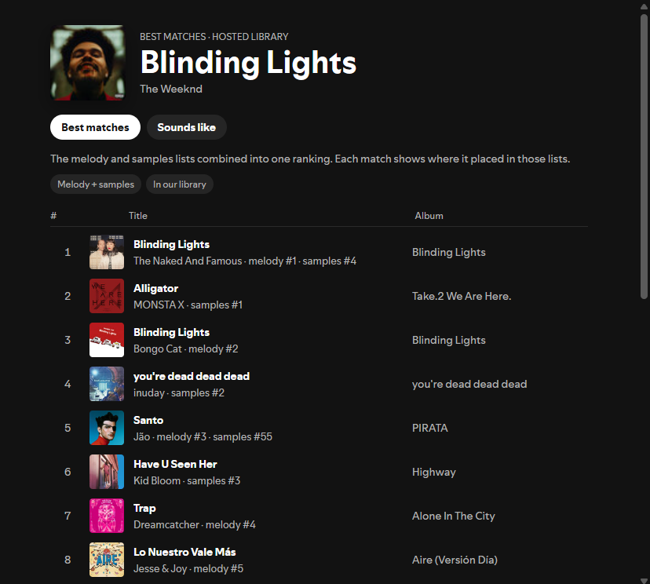

# Soundalike

Find tracks that sound like the song you are playing, directly
inside Spotify. Soundalike compares audio embeddings instead of using genres,
popularity, or listening-history recommendations. Results open on **Best
matches**, songs that share a melody, sample, or loop with yours. The **Same
vibe** and **Sounds like** tabs list songs with the same feel and the same
overall sound.

## Use it

1. Install **Soundalike** from Marketplace.
2. Right-click any track in Spotify, including the song playing in the player
   bar.
3. Select **Find soundalikes**. Results open on **Best matches**; select
   **Sounds like** to switch lists.
4. Double-click a result or use its left-side play button. The list then plays
   on in the order shown, like a playlist that is never saved. Right-click a
   result for Spotify's normal track actions.

That is all normal use requires. There is no Soundalike account, Python
installation, terminal command, or local server to configure. The extension
automatically uses Soundalike's hosted services.

### Marketplace updates

Marketplace now installs a small, commit-pinned bootstrap. On Spotify start it
checks a signed stable release feed, verifies the signature, immutable Git
commit URL, SHA-256 hash, and browser SRI before loading the runtime. It keeps
the last verified runtime locally and falls back to that runtime (then its
baked-in runtime) if an update cannot be trusted or fetched. Future signed
runtime releases do **not** require a Marketplace manifest change.

**Existing Marketplace users must reinstall once**: uninstall Soundalike in
Marketplace, install it again, and restart Spotify. Older immutable runtime
copies cannot update themselves. After that final reinstall, runtime updates
are automatic. Manual installs remain manual; use the current file and run
`spicetify apply` when updating.

## Best matches and Sounds like

Results come in up to three lists. Switch between them with the tabs, or with
the arrow, Home, and End keys. Spotify's Back and Forward buttons keep the list
you chose.

- **Best matches** (the default) combines two rankings from Soundalike's
  any-song matcher: songs with the same melody (covers, interpolations, and
  reused tunes) and songs that share a sample or loop. Each row shows where it
  placed in those rankings, such as "melody #1 · samples #3". The matcher
  searches a 999,293-song index and works for any song with a 30-second
  Deezer preview, including songs outside the index, which take a few seconds
  to analyze. After the likely covers and samples, songs are ordered by how
  likely your song's listeners are to also play their artists, as learned from
  public listening data, and by how close they sound. Rows from that part of the
  list may show no melody or samples rank. Each artist appears once in that
  part of the top 10 and never twice in a row. Other-language songs are hidden when the seed language is known;
  a song without a language label of its own counts in its artist's usual
  language, and songs with neither stay visible. Use **Show all languages**
  to restore cross-language matches. If the seed language cannot be established,
  no language filter is applied. Close copies of your own song by other artists
  (re-uploads, edits) are left out, and at most three other versions of it are
  shown. Tags say whether your song was **In our library**,
  **Heard live just now**, or **Heard live earlier**. If the matcher used a song
  with a different title or artist, the list names it.
- **Same vibe** comes from the same hosted response as Best matches: songs from
  those matches that share your song's tempo and overall sound, topped up with
  similar-sounding songs, one per artist. It follows the same **Show all
  languages** switch. The tab only appears when the hosted matcher sends this
  list, and not with the local companion.
- **Sounds like** comes from the same hosted response too: songs with the same
  overall sound (instruments, production, and mood) by Soundalike's MuQ-MuLan
  model, one per artist, with each song's BPM. Among similar-sounding songs,
  those by artists your song's listeners also play move up. It also follows the **Show all
  languages** switch, and like the other two lists it works for any song with a
  Deezer preview. Until November 2026 this tab used an older model that only
  knew a fixed 272,853-track library; that service now only answers when the
  hosted matcher can't, and for the local companion.

The page opens as soon as the hosted matcher answers, or after four seconds
with the lists still loading. If Best matches fail, for example because Deezer
has no preview of the song, the older Sounds like service is asked instead and
the page shows its list with a note, unless you already picked a tab. If both
fail, a notification explains why.

With a healthy [local companion](SETUP.md), results open on Sounds like, which
stays on your computer: it comes from the companion's own engine, with BPM,
Spotify lyrics-language filtering, related-artist ordering, and the feedback
prompt. Best matches only run on the hosted matcher, so their tab asks before
sending the song's title and artist. A Best matches list saved from an earlier
search shows without asking.

## Spotify-native results

- Results open on a normal Spotify page, so the Back and Forward buttons work
  and the list stays visible while music plays.
- Results use a playlist-style layout with album artwork, verified artist
  names, clickable album names, and, in Sounds like, measured BPM.
- Best matches, Same vibe, and hosted Sounds like show the first 20 songs of
  the matcher's top 30 that Spotify has, in the matcher's order. A song
  Spotify doesn't have, such as a Deezer-only upload, is left out and the next
  one takes its place; the songs left out are named under the list, and
  clicking one searches Spotify for it in case the match was missed. A row
  whose Spotify lookup fails, or takes more than five seconds, still shows,
  with a Spotify search instead of playback; a slow one becomes playable when
  its song arrives. If Spotify finds none of the songs, they all show this way.
- In the companion's Sounds like list (and the older service's fallback list),
  for a seed with a known Spotify lyrics language, only
  candidates with that exact known language are shown (English with English,
  French with French, and so on). Best matches, Same vibe, and hosted Sounds
  like use the server's audio-derived language gate instead: confidently
  different-language songs are hidden by default (judged by the song's own
  label, else its artist's usual language),
  uncertain/instrumental rows remain, and **Show all languages** restores the
  unfiltered list. The individual melody, samples, and sounds tabs are not
  filtered, so cross-language covers and samples remain explorable. The Sounds-like gate examines only
  the model's original top 20: it never
  promotes a weak lower-ranked song merely because that song has language
  metadata. Each candidate stays hidden until its own check finishes; verified
  exact-language rows appear progressively and are never later removed for a
  language mismatch.
- Different-language candidates and candidates with confirmed unavailable
  lyrics metadata are hidden rather than used as fallbacks, so strict
  filtering can return fewer than 20 results. "No lyrics metadata" does not
  mean Spotify detected a foreign language; it means language could not be
  established safely.
- Temporary Spotify language failures are retried and are not cached as
  permanent unknowns. Among exact-language candidates in the top 20, artists
  Spotify directly relates to the seed artist are shown first while preserving
  the model order within each group. Same-artist matches are no longer blocked,
  remix/version variants are softly penalized so originals stay ahead, and
  global notability can only reorder the top 1,000 audio-qualified tail
  candidates at 25% strength.
- If Spotify has no language for the seed, that list preserves the normal
  ranking. Lyrics metadata alone cannot safely distinguish an instrumental
  from a metadata failure.
- The play button on a verified result plays that exact Spotify track
  immediately without closing or leaving the page. Double-clicking anywhere
  on the row does the same; a single click does not interrupt playback.
- Playback continues down the list you are viewing, in the order shown, like
  Spotify's song radio: the next row plays next, and Previous goes back up the
  list. Hidden rows and rows without a verified Spotify track are skipped, and
  no playlist is created. Rows still being matched to Spotify when you press
  play join the queue, in order, once the list reaches its last song. The row
  of the song that is playing is highlighted.
- The green play button next to your song's title plays your song again, then
  continues down the list you are viewing, like a song radio that starts from
  your song.
- **Find soundalikes** is also in the menu of the song in the player bar.
  Spicetify 2.46.4 and earlier pass that menu no song, so extension items are
  normally missing there; Soundalike adds its item itself and uses the song
  that is playing.
- Right-clicking a result opens Spotify's native menu with **Find soundalikes**
  again, plus playlists, queueing, song radio, artist and album navigation,
  credits, and sharing.
- If Spotify cannot confidently match a recommendation, Soundalike safely
  searches Spotify's full Songs results before falling back to a Spotify search
  page. It never plays a low-confidence match.
- Both successful lists and resolved Spotify metadata are cached locally for
  seven days, so reopening the same track avoids repeating the expensive
  recommendation and catalog lookups. Unresolved Spotify searches and failed
  language checks are not cached, so a temporary miss can recover.
- Once the companion's (or fallback) Sounds like list's language filtering and
  final ordering settle, a
  compact inline prompt may ask **How close were these matches?** A prompt you
  close stays closed when you switch tabs. Choose **Good**, **Mixed**, or
  **Off**. Mixed and Off reveal up to two optional reason chips and an optional
  280-character note; the note explicitly warns against personal information.
  Nothing is sent until **Send feedback** is pressed, and failures remain
  retryable. The prompt appears after each completed result set unless you opt
  out. **Not now** hides only the current prompt; after the second dismissal,
  the extension asks whether it should keep showing the survey. **Yes** keeps
  showing it after future searches, while **No** stores an opt-out locally.

## Privacy

For Best matches, Same vibe, and Sounds like, Soundalike sends the selected
track's title, artist and, when Spotify lists one, its recording code (ISRC)
to `https://soundalike.yassin.app/api/anysong/similar`,
which may look the song up on Deezer and analyze Deezer's public 30-second
preview. Only when that matcher can't answer does it send the same title and
artist to the older Sounds like service at `https://soundalike-api.yassin.app`
(then `https://soundalike.yassin.app` as a fallback). To read the ISRC, the
extension asks Spotify's own track metadata inside the desktop client.
The matcher keeps recent results in memory so repeat searches are fast. When
it analyzes a song that isn't in its catalog yet, it also writes that song's
Deezer track and artist IDs and the date to a list the catalog crawl reads, so
the catalog grows toward songs people look up. Nothing about who asked (no
address, account, or request details) is written. With a
healthy local companion, Sounds like stays on your computer and Best matches
ask first. Soundalike never sends audio, your Spotify password, access token,
library, listening history, or artwork. Language
labels and related-artist context come directly from Spotify inside the
already-authenticated desktop client and are not sent to Soundalike. No
separate Spotify login is required.

Optional feedback is sent to the public CORS endpoint at
`https://soundalike.yassin.app/api/spicetify-feedback`. Its record contains only
the seed title/artist, the rows actually displayed and their final order,
method/index/API/language/selection policy labels, Good/Mixed/Off, selected
closed reasons, the optional note, and random anonymous install/session
nonces used for retry deduplication. It does **not** include Spotify account
identity, credentials, access tokens, library, listening history, request
headers, IP addresses, or hidden candidates. The endpoint returns only a
receipt digest; the extension never receives a private storage URL.

The maintainer may receive a private Discord notification containing the
Good/Mixed/Off selection, seed title and artist, selected reasons, number of
displayed results, and a short receipt. Optional notes, anonymous nonces, and
the displayed result list are not sent to Discord.

## Good to know

- Hosted Sounds like comes from the same GPU matcher as Best matches. The older
  Sounds like service it replaced is only asked when that matcher can't answer;
  it quietly prewarms its Vercel fallback after Spotify starts, and if its
  primary service is unavailable, the first fallback request after idle can
  take up to about 30 seconds. Repeated tracks use the local cache, and hosted
  responses can be reused by the CDN.
- The matcher picks its Best matches, Same vibe, and Sounds like results from
  a 999,293-song catalog. Songs added by the catalog crawl are only suggested
  for songs from their artist's scene. The older Sounds like library covers
  272,853 tracks.
- Best matches hear only Deezer's 30-second preview, so a melody or sample
  outside that clip can be missed.
- The matcher allows about 20 new searches a minute. Past that, Best matches
  say **You're going a bit fast**; wait a few seconds and try again. Lists
  saved on your computer don't count.
- The companion's and the fallback Sounds like ranking use the independently
  validated `dual_sonic64_guardrail` model. The `v=4` value in their requests
  is the strict Spotify-lyrics policy contract, not a V4 recommendation model.
  It invalidates permissive cached results. If the always-on service has not
  received that contract yet, the extension goes directly to the current
  Vercel ranker instead of accepting an older compatibility ranking.
- The completed V5 receipt favored the full-track acoustic control by 56/96
  pairwise choices, versus 54/96 for the preference head and 46/96 for fixed
  V4. That research scorer depends on Jamendo full-track section embeddings
  unavailable for arbitrary Spotify songs, so it is not falsely presented as
  the production ranker. V5's exact-language behavior is the deployable policy
  promoted here.
- Spotify availability and Soundalike library coverage are different. The
  extension can now resolve recommendations through Spotify's full Songs
  search, but a Spotify seed that is absent from the 272,853-track embedding
  index still cannot be analyzed by the hosted Sounds like model. Best matches
  still analyze it live when Deezer has a preview of it.
- If **Find soundalikes** does not appear immediately after installation,
  fully quit and reopen Spotify.
- Spotify 1.3.5 and newer need Spicetify 2.46.1 or newer. If Spotify says
  **Find soundalikes is off**, or right-click menus open empty, run
  `spicetify update`; it updates Spicetify and applies it again.
- If a Spotify update breaks Spicetify features, update Spicetify and run
  `spicetify backup apply`.

Want private local Sounds like queries, local analysis for tracks outside the
hosted library, or a manual installation? See the
[advanced setup guide](SETUP.md).

Not using Spicetify? Try the [hosted web app](https://soundalike.yassin.app).
