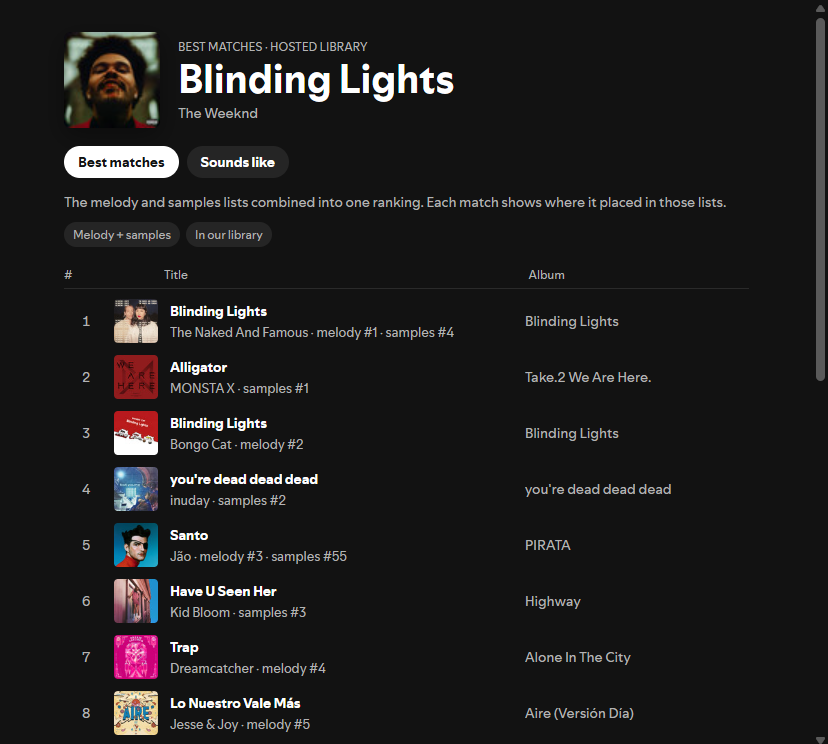

# Soundalike

Find tracks that sound like the song you are playing, directly
inside Spotify. Soundalike compares audio embeddings instead of using genres,
popularity, or your listening history. Results open on **Best matches**: songs
that share a melody, sample, or loop with yours, then the songs a model ranks
closest to it from five signals. **Listeners also play** lists similar songs by
other artists that your song's listeners also play.

## Use it

1. Install **Soundalike** from Marketplace.
2. Right-click any track in Spotify, including the song playing in the player
   bar.
3. Select **Find soundalikes**. Results open on **Best matches**; select
   **Listeners also play** to switch lists.
4. Double-click a result or use its left-side play button. The list then plays
   on in the order shown, like a playlist that is never saved. Right-click a
   result for Spotify's normal track actions.

That is all normal use requires. There is no Soundalike account, Python
installation, terminal command, or local server to configure. The extension
automatically uses Soundalike's hosted services.

### Marketplace updates

Marketplace now installs a small, commit-pinned bootstrap. On Spotify start it
checks a signed stable release feed, verifies the signature, immutable Git
commit URL, SHA-256 hash, and browser SRI before loading the runtime. It keeps
the last verified runtime locally and falls back to that runtime (then its
baked-in runtime) if an update cannot be trusted or fetched. Future signed
runtime releases do **not** require a Marketplace manifest change.

**Existing Marketplace users must reinstall once**: uninstall Soundalike in
Marketplace, install it again, and restart Spotify. Older immutable runtime
copies cannot update themselves. After that final reinstall, runtime updates
are automatic. Manual installs remain manual; use the current file and run
`spicetify apply` when updating.

## Best matches, Listeners also play and Melody match

Results come in three lists from one answer. Switch between them with the
tabs, or with the arrow, Home, and End keys. The tab you chose last is where
the next search opens.

- **Best matches** (the default) starts with likely covers and samples.
  Soundalike's any-song matcher ranks songs with the same melody (covers,
  interpolations, and reused tunes) and songs that share a sample or loop; a
  melody or samples match that clearly stands out from the song's other matches
  leads the list, and its row shows where it placed in those rankings, such as
  "melody #1 · samples #3". Many songs have none. After them come other artists'
  songs, one per artist, ordered by a small model that weighs five signals for
  every song in the index: how close it sounds (instruments, production, and
  mood, by Soundalike's MuQ-MuLan model), how close its scene is, whether
  public playlists put the two songs together, and how it places in the melody
  and samples rankings. The model was trained on graded examples of good and
  poor matches; popularity is not one of its inputs. The matcher searches about
  1.1 million songs and works for any song with a 30-second Deezer preview,
  including songs outside the index, which take a few seconds to analyze.
  Other-language songs are hidden when the seed language is known; a song
  without a language label of its own counts in its artist's usual language,
  and songs with neither stay visible. Use **Show all languages** to restore
  cross-language matches. If the seed language cannot be established, no
  language filter is applied. Close copies of your own song by other artists
  (re-uploads, edits) are left out, and at most three other versions of it are
  shown. Tags say whether your song was **In our library**,
  **Heard live just now**, or **Heard live earlier**. If the matcher used a song
  with a different title or artist, the list names it.
- **Listeners also play** comes from the same hosted response: songs by other
  artists among everything the matcher found for your song, one per artist,
  ordered mostly by how likely your song's listeners are to also play them and
  partly by how close they sound. It follows the same **Show all languages**
  switch. When Soundalike has no listening data for the artist yet, this tab
  says so; Best matches is not affected.
- **Melody match** is the list Best matches showed before November 2026: likely
  covers, samples and shared melodies first, from the melody and sample
  matches fused into one ranking, each row saying where it placed ("melody #1
  · samples #3"), then similar-sounding songs by artists your song's listeners
  also play, marked **Listeners also play**. With Audio only it is the fused
  melody and sample ranking alone. It follows the same **Show all languages**
  switch and needs no extra request.
- **Sounds like** only appears with the [local companion](SETUP.md), or in
  place of Best matches when the hosted matcher can't take the song (see
  below).

**Audio only**, next to **Show all languages**, leaves scene, playlist and
listening data out: Best matches then lists the songs that sound most alike in
sound order after the likely covers and samples, and Listeners also play stays
empty. The choice is remembered for later searches; turn it off to get the
full lists back. In the companion's (or fallback) Sounds like list it also
turns off the related-artist ordering.

The page opens as soon as the hosted matcher answers, or after four seconds
with the lists still loading. If Best matches fail, for example because Deezer
has no preview of the song, the older Sounds like service is asked instead and
the page shows its list in a **Sounds like** tab with a note, unless you already
picked a tab. If both fail, a notification explains why.

With a healthy [local companion](SETUP.md), results open on Sounds like, which
stays on your computer: it comes from the companion's own engine, with BPM,
Spotify lyrics-language filtering, related-artist ordering, and the feedback
prompt. Best matches and Listeners also play only run on the hosted matcher, so
their tabs ask before sending the song's title and artist. Lists saved from an
earlier search show without asking.

## Show more, Recent, and coming back to a list

- Each list shows 20 songs. **Show more** under it adds the next 20, up to the
  50 the matcher returns for a song. The first answer already holds all of
  them, so Show more asks the matcher nothing; it only looks the new songs up
  on Spotify.
- The page is a place you can return to. A **Soundalike results** button in
  Spotify's top bar, next to Back and Forward, reopens it from anywhere, as you
  left it: the same tab, the songs you added with Show more, and the scroll
  position. Spotify's own Back and Forward step through your earlier searches.
- **Recent**, at the top right of the page, lists your last 20 searches. A
  search reopens from the lists saved on this computer (kept for a week), so
  nothing is asked of the matcher again; **Clear** empties the list. After a
  Spotify restart the top bar button opens your latest search.
- Playing a song never closes or changes the page.

## Themes

The page sits inside Spotify's main view and takes its colours from the
theme. Checked on Spotify 1.3.10 with Spicetify 2.46.4: no theme, the
Marketplace default, Lucid, DefaultDynamic, Comfy, Bloom, Catppuccin (mocha
and the light latte), Sleek, text and Dribbblish. With Lucid, releases up to
2.14.0 showed an empty page; 2.15.0 fixes that.

## Match

Rows in Best matches and Listeners also play show a **Match** bar to the left
of Stems: how strongly Soundalike ranks the song for yours, which never rises
down a list. Hover it for the number and, on rows other than the ones the
Best matches model placed, the sound match: how alike the song sounds to yours
by the MuQ-MuLan model, as the share of typical matches it sounds more alike
than (50 % is a typical match). A likely cover or sample can lead the list
with a low sound match, and a song with few close matches gets low bars
throughout. In a narrow window only the bar shows.

## Stems

Rows in Best matches and Listeners also play have a **Stems** button. It
shows your song and that match side by side, each split into vocals,
drums, bass, guitar, keys, and synths & other by the `htdemucs_6s` separation
model, then measured part by part:

- **How alike, part by part** compares each part's sound, the groove, tempo,
  key and harmony, vocal register, range and presence, the bassline, and the
  mix balance. Each gets a 0–100 grade against typical match pairs, and up to
  three graded 85 or more are listed as **Matched on**. A part missing from
  either song isn't graded. If the server has no calibration, the view shows
  the raw measures in their own units.
- For each song: the loudness of the whole mix and of each part across the
  30-second preview, the beat grid, the sung and bass melody lines, kick,
  snare, and hat hits, and an average one-bar drum pattern. A part the
  separator doesn't find is dimmed and marked **not in this song**.
- ▶ plays either song.

**Back** or Escape returns to the list where you left it. Songs already
dissected open at once; others are split on the server's GPU, which takes up to
about half a minute. Like Best matches, Stems hears only Deezer's 30-second
preview. The companion's local Sounds like list has no Stems button.

## Spotify-native results

- Results open on a normal Spotify page, so the Back and Forward buttons work
  and the list stays visible while music plays.
- Results use a playlist-style layout with album artwork, verified artist
  names, clickable album names, and, in Sounds like, measured BPM.
- Best matches, Listeners also play and Melody match show the first 20 songs
  of the matcher's top 50 that Spotify has, in the matcher's order, and 20
  more with each **Show more**. A song
  Spotify doesn't have, such as a Deezer-only upload, is left out and the next
  one takes its place; the songs left out are named under the list, and
  clicking one searches Spotify for it in case the match was missed. A row
  whose Spotify lookup fails, or takes more than five seconds, still shows,
  with a Spotify search instead of playback; a slow one becomes playable when
  its song arrives. Once one lookup is that slow, the remaining rows no longer
  wait for theirs, so a Spotify search that is slow or stuck can't leave the
  list empty. If Spotify finds none of the songs, they all show this way. A
  row whose right-click menu Spotify fails to draw shows without that menu.
- In the companion's Sounds like list (and the older service's fallback list),
  for a seed with a known Spotify lyrics language, only
  candidates with that exact known language are shown (English with English,
  French with French, and so on). Best matches and Listeners also play use
  the server's audio-derived language gate instead: confidently
  different-language songs are hidden by default (judged by the song's own
  label, else its artist's usual language),
  uncertain/instrumental rows remain, and **Show all languages** restores the
  unfiltered list. The individual melody, samples, and sounds tabs are not
  filtered, so cross-language covers and samples remain explorable. The Sounds-like gate examines only
  the model's original top 20: it never
  promotes a weak lower-ranked song merely because that song has language
  metadata. Each candidate stays hidden until its own check finishes; verified
  exact-language rows appear progressively and are never later removed for a
  language mismatch.
- Different-language candidates and candidates with confirmed unavailable
  lyrics metadata are hidden rather than used as fallbacks, so strict
  filtering can return fewer than 20 results. "No lyrics metadata" does not
  mean Spotify detected a foreign language; it means language could not be
  established safely.
- Temporary Spotify language failures are retried and are not cached as
  permanent unknowns. Among exact-language candidates in the top 20, artists
  Spotify directly relates to the seed artist are shown first while preserving
  the model order within each group. Same-artist matches are no longer blocked,
  remix/version variants are softly penalized so originals stay ahead, and
  global notability can only reorder the top 1,000 audio-qualified tail
  candidates at 25% strength.
- If Spotify has no language for the seed, that list preserves the normal
  ranking. Lyrics metadata alone cannot safely distinguish an instrumental
  from a metadata failure.
- The play button on a verified result plays that exact Spotify track
  immediately without closing or leaving the page. Double-clicking anywhere
  on the row does the same; a single click does not interrupt playback.
- Playback continues down the list you are viewing, in the order shown, like
  Spotify's song radio: the next row plays next, and Previous goes back up the
  list. Hidden rows and rows without a verified Spotify track are skipped, and
  no playlist is created. Rows still being matched to Spotify when you press
  play join the queue, in order, once the list reaches its last song. Those
  songs leave Spotify's queue again when you play another list or a song
  outside the list, so the next song is never one left over from an earlier
  list. Stems' ▶ also plays within the list. The row
  of the song that is playing is highlighted.
- The green play button next to your song's title is only for your song. It
  plays your song again, then continues down the list you are viewing, like a
  song radio that starts from your song. While your song is the one playing,
  it pauses and resumes it instead; while another song from the list plays, it
  starts your song again.
- **Find soundalikes** is also in the menu of the song in the player bar.
  Spicetify 2.46.4 and earlier pass that menu no song, so extension items are
  normally missing there; Soundalike adds its item itself and uses the song
  that is playing.
- Right-clicking a result opens Spotify's native menu with **Find soundalikes**
  again, plus playlists, queueing, song radio, artist and album navigation,
  credits, and sharing.
- If Spotify cannot confidently match a recommendation, Soundalike safely
  searches Spotify's full Songs results before falling back to a Spotify search
  page. It never plays a low-confidence match.
- Both successful lists and resolved Spotify metadata are cached locally for
  seven days, so reopening the same track avoids repeating the expensive
  recommendation and catalog lookups. Unresolved Spotify searches and failed
  language checks are not cached, so a temporary miss can recover.
- Once the companion's (or fallback) Sounds like list's language filtering and
  final ordering settle, a
  compact inline prompt may ask **How close were these matches?** A prompt you
  close stays closed when you switch tabs. Choose **Good**, **Mixed**, or
  **Off**. Mixed and Off reveal up to two optional reason chips and an optional
  280-character note; the note explicitly warns against personal information.
  Nothing is sent until **Send feedback** is pressed, and failures remain
  retryable. The prompt appears after each completed result set unless you opt
  out. **Not now** hides only the current prompt; after the second dismissal,
  the extension asks whether it should keep showing the survey. **Yes** keeps
  showing it after future searches, while **No** stores an opt-out locally.

## Privacy

For Best matches and Listeners also play, Soundalike sends the selected
track's title, artist and, when Spotify lists one, its recording code (ISRC)
to `https://soundalike.yassin.app/api/anysong/similar`,
which may look the song up on Deezer and analyze Deezer's public 30-second
preview. Only when that matcher can't answer does it send the same title and
artist to the older Sounds like service at `https://soundalike-api.yassin.app`
(then `https://soundalike.yassin.app` as a fallback). To read the ISRC, the
extension asks Spotify's own track metadata service from inside the desktop
client, using the client's access token, which goes only to Spotify.
The matcher keeps recent results in memory so repeat searches are fast. When
it analyzes a song that isn't in its catalog yet, it also writes that song's
Deezer track and artist IDs and the date to a list the catalog crawl reads, so
the catalog grows toward songs people look up. Nothing about who asked (no
address, account, or request details) is written. With a
healthy local companion, Sounds like stays on your computer, and Best matches
and Listeners also play ask first. Soundalike never sends audio, your Spotify password, access token,
library, listening history, or artwork. Language
labels and related-artist context come directly from Spotify inside the
already-authenticated desktop client and are not sent to Soundalike. No
separate Spotify login is required.

Opening **Stems** sends the two songs' Deezer track IDs, taken from the
matcher's own list, to `https://soundalike.yassin.app/api/anysong/dissect`.
The server may download their public Deezer previews to split and measure them,
and keeps the measurements so the next look is instant. As with searches,
nothing about who asked is kept.

Optional feedback is sent to the public CORS endpoint at
`https://soundalike.yassin.app/api/spicetify-feedback`. Its record contains only
the seed title/artist, the rows actually displayed and their final order,
method/index/API/language/selection policy labels (the selection policy says
whether **Audio only** was on), Good/Mixed/Off, selected
closed reasons, the optional note, and random anonymous install/session
nonces used for retry deduplication. It does **not** include Spotify account
identity, credentials, access tokens, library, listening history, request
headers, IP addresses, or hidden candidates. The endpoint returns only a
receipt digest; the extension never receives a private storage URL.

The maintainer may receive a private Discord notification containing the
Good/Mixed/Off selection, seed title and artist, selected reasons, number of
displayed results, and a short receipt. Optional notes, anonymous nonces, and
the displayed result list are not sent to Discord.

## Good to know

- Best matches and Listeners also play come from one request to the GPU
  matcher. The older Sounds like service is only asked when that matcher can't
  answer;
  it quietly prewarms the web app fallback after Spotify starts, and if its
  primary service is unavailable, the first fallback request after a restart can
  take up to about 30 seconds. Repeated tracks use the local cache, and hosted
  responses can be reused by the CDN.
- The matcher picks Best matches and Listeners also play from a catalog of
  about 1.1 million songs. Outside the model-ranked part of Best matches, songs
  added by the catalog crawl are only suggested for songs from their artist's
  scene. The older Sounds like library covers 272,853 tracks.
- Best matches hear only Deezer's 30-second preview, so a melody or sample
  outside that clip can be missed.
- The matcher allows about 20 new searches a minute. Past that, Best matches
  say **You're going a bit fast**; wait a few seconds and try again. Lists
  saved on your computer don't count. Stems allows about 12 songs a minute
  that haven't been dissected yet; songs already dissected don't count.
- The companion's and the fallback Sounds like ranking use the independently
  validated `dual_sonic64_guardrail` model. The `v=4` value in their requests
  is the strict Spotify-lyrics policy contract, not a V4 recommendation model.
  It invalidates permissive cached results. If the always-on service has not
  received that contract yet, the extension goes directly to the current
  web app ranker instead of accepting an older compatibility ranking.
- The completed V5 receipt favored the full-track acoustic control by 56/96
  pairwise choices, versus 54/96 for the preference head and 46/96 for fixed
  V4. That research scorer depends on Jamendo full-track section embeddings
  unavailable for arbitrary Spotify songs, so it is not falsely presented as
  the production ranker. V5's exact-language behavior is the deployable policy
  promoted here.
- Spotify availability and Soundalike library coverage are different. The
  extension can now resolve recommendations through Spotify's full Songs
  search, but a Spotify seed that is absent from the 272,853-track embedding
  index still cannot be analyzed by the older Sounds like service. Best matches
  still analyze it live when Deezer has a preview of it.
- If **Find soundalikes** does not appear immediately after installation,
  fully quit and reopen Spotify.
- Spotify 1.3.5 and newer need Spicetify 2.46.1 or newer. If Spotify says
  **Find soundalikes is off**, or right-click menus open empty, run
  `spicetify update`; it updates Spicetify and applies it again.
- If a Spotify update breaks Spicetify features, update Spicetify and run
  `spicetify backup apply`.

Want private local Sounds like queries, local analysis for tracks outside the
hosted library, or a manual installation? See the
[advanced setup guide](SETUP.md).

Not using Spicetify? Try the [hosted web app](https://soundalike.yassin.app).
